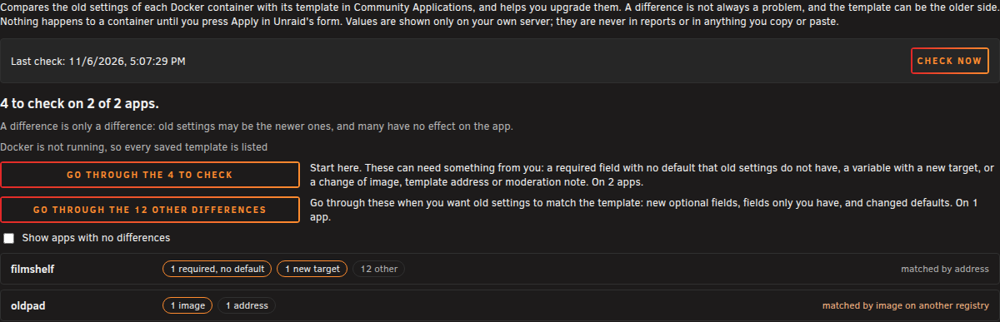
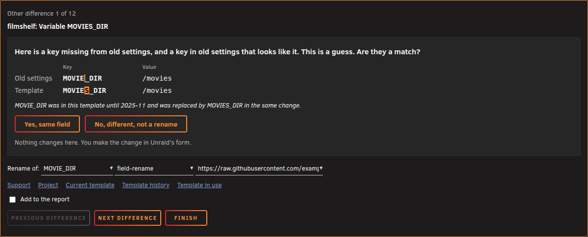
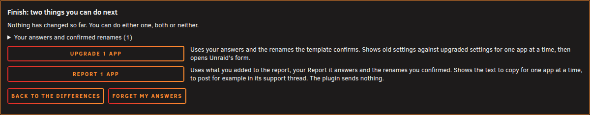
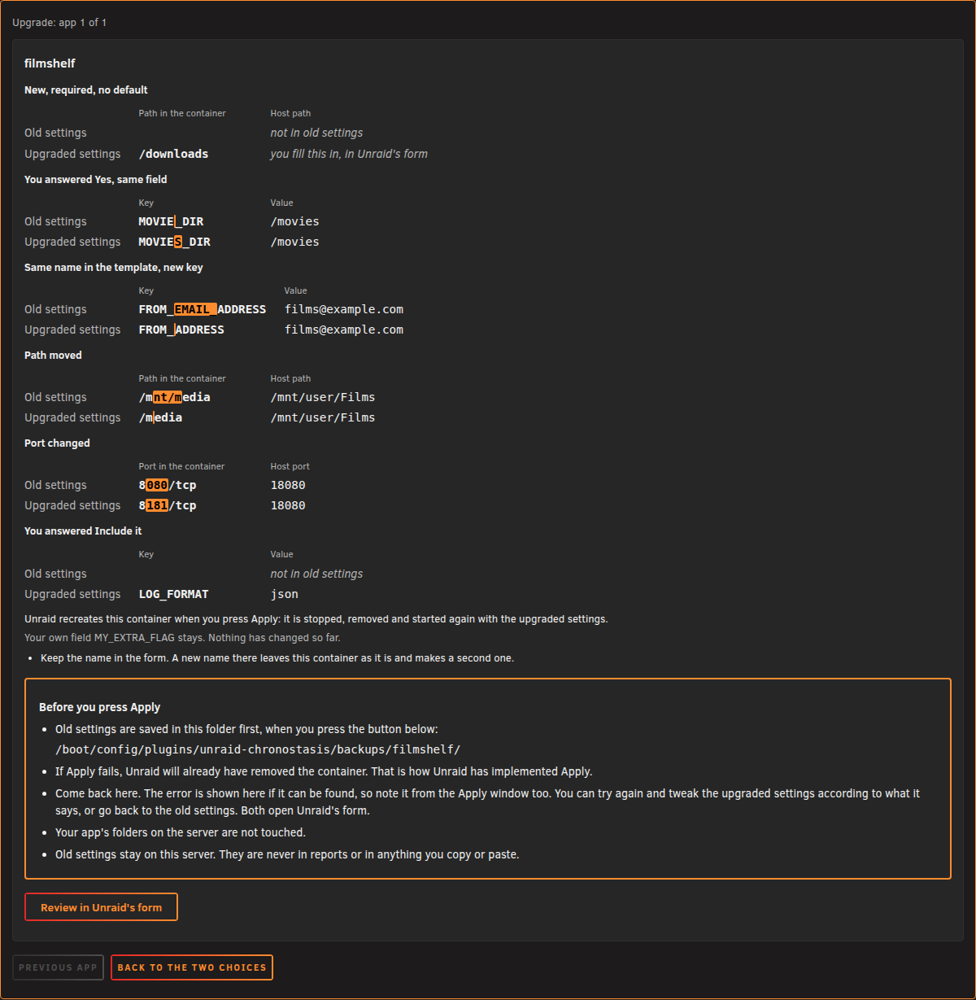
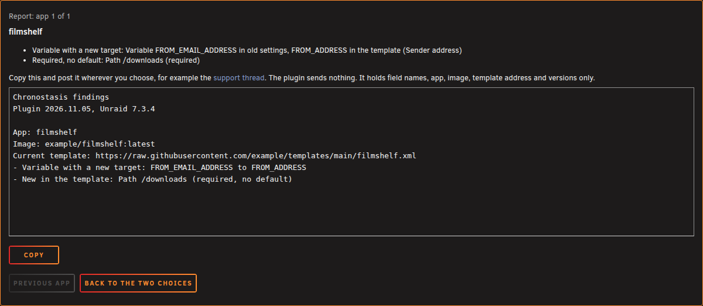

# Chronostasis for Unraid

Unraid keeps your own copy of a Docker template when you install an app: your old settings. Community Applications templates keep moving: new fields, renamed fields, new images, new addresses. Old settings stay as they were, and nothing tells you.

Chronostasis compares old settings with the template in Community Applications, asks about each difference, and opens the upgraded settings in Unraid's form. Nothing happens to a container until you press Apply there. It sends nothing.

A difference is not always a problem, and the template can be the older side.

## Screenshots

The check: how many differences to look at, and two ways through them.

One difference, with its question.

Finish: upgrade, report, both or neither.

Upgrade: old settings against upgraded settings, before Unraid's form opens.

Report: the text to copy, with no values in it.

## What it shows, per app

Counted as something to check:

- A required field with no default that old settings do not have
- A variable that keeps its name but has a new target
- A different image, or a saved template address that is gone or not the one Community Applications lists
- Community Applications moderator comments, deprecated and blacklisted apps

Everything else stays collapsed under Other differences for each app:

- Other fields new in the template, and fields only in old settings
- Fields whose required flag or default differs

Also shown: ports that do not apply, because the app shares another container's network, and fields you turned off, which are not compared.

There are two ways through, each one difference at a time, with a diagnosis and links to the app's support, project, current template and template in use. Start with the ones to check. The other differences are for when you want old settings to match the template. Dismiss what you have checked; it returns if the template changes that item.

Each field shows old settings above and the template below, with your value carried over, and one question:

- A field only in old settings: is it your own, or do you want to report it and ask what it means?
- A new field in the template: do you want to include it?
- A new field that looks like one in old settings: are they a match? This is a guess, and you can pick another field to compare.

A different image or a template address that has moved is never changed here. The maintainer may have changed too much for a plugin to judge, so these screens say why and what you can do: find out why it changed, stay where you are, or treat it as a reinstall.

## Finish: upgrade or report

Finish offers two separate next steps, each one app at a time. Your answers and the renames the template confirms are listed there, so you can see what goes where.

Your answers stay in this browser if you reload the page, and the walk continues where you left off. They hold names only, no values. Forget my answers clears them.

### Upgrade

You see old settings above and upgraded settings below, and what the form would change on its own. Review in Unraid's form saves old settings to the flash drive first, then opens the form filled in, so nothing has to be typed or copied. Check it and press Apply. Backups are kept until you delete them.

If Apply fails, Unraid will already have removed the container. That is how Unraid has implemented Apply. Come back to the page: the error is shown if it can be found, and you can try again with the upgraded settings or go back to the old settings. Both open Unraid's form. Your app's folders on the server are not touched.

Unraid does not keep every error. To find it, Chronostasis can check the image again and create a temporary container with only the image and the extra parameters. That container never starts and is removed at once.

Unraid's form saves only the fields it knows. A memory limit (`<Memory>`) and extra networks (`<ExtraNetworks>`) have their own fields from Unraid 7.4 on; the form in 7.3 and 6.12 has neither. So if the settings to open hold one of them and the form on your server has no field for it, Chronostasis says so before the form opens: pressing Apply there would remove it. It says what to do instead: for a memory limit, add `--memory=<the limit>` to Extra Parameters in the form; extra networks can be connected again with `docker network connect` after Apply, until the container is next recreated. Chronostasis reads this from the form's own code, not from the version number.

Compose containers are left alone. An app that stays on its own version says so: the comparison is with the current template, which may describe a newer version.

Backups stay on the flash drive. If an app's container and saved settings are gone, its backups are listed on the page and open in Unraid's form.

Values are shown only on your own server; they are never in reports or in anything you copy or paste.

### Report

The report holds only what you added to it or asked about; nothing goes in by itself. Each app gets its own text to copy, with a link to its support thread: field names, app, image, template addresses, and the plugin and Unraid versions, plus any field mappings you added. Post it wherever you choose. Hostnames, IP addresses and share paths are left out.

## Install

Requires Unraid 6.12 or later. In **Plugins, Install Plugin**, paste:

    https://raw.githubusercontent.com/luuvasara/unraid-chronostasis/main/unraid-chronostasis.plg

Nothing is checked at install or at boot. Open **Settings, Chronostasis** and press **Check now**.

## What a check does

It reads the saved templates in `/boot/config/plugins/dockerMan/templates-user`, gets the Community Applications feed (or uses the copy Fix Common Problems downloaded in the last day), and asks each saved template address for its status. The report stays in RAM. On the flash drive it writes only in its own folder: the dismiss list, and the backups of old settings when you upgrade an app. The upgraded settings stay in RAM until Apply has worked.

## License

GPL-2.0, see [LICENSE](LICENSE).
